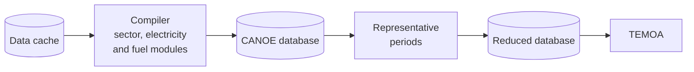

<p align="center">
  
</p>

# CANOE

[](https://github.com/CANOE-main/CANOE/actions/workflows/docs.yml)
[](https://CANOE-main.github.io/CANOE/)
[](https://github.com/CANOE-main/CANOE/releases)
[](LICENSE)
[](https://github.com/CANOE-main/CANOE/issues)
[](pyproject.toml)

The Canadian Open Energy Model (CANOE) is a capacity expansion model for the Canadian
energy system: given projected energy demand, it finds the lowest-cost mix of
technologies to build and operate to meet it. It's built as an instance of
[TEMOA](https://temoacloud.com/), populated with open Canadian data across the
electricity, transportation, industry, residential, commercial, agriculture and fuels
sectors.

This repository is the **CANOE compiler**: the Python package that turns that open data
into a TEMOA database for the provinces, periods and settings you choose, reduces it to
representative days and runs TEMOA on it.

- **Documentation:** <https://CANOE-main.github.io/CANOE/>
- **Step-by-step tutorial:** [Get Started](https://CANOE-main.github.io/CANOE/get_started/)

## Get started

To run CANOE, TEMOA needs a database in its format: the technologies, demands, costs
and time slices of the energy system, for the provinces and years being modelled. The
**compiler** builds that database, aggregating the external data sources (NRCan, CER,
StatCan, CODERS, NREL, EIA, ...) into TEMOA's tables. Before TEMOA runs, the database is
reduced to **representative periods**: a model with every hour of every day for each
province and decade is far too large to optimize, so a handful of days (a cold winter
day, a windy spring one, a hot summer one, ...) stand in for the whole year, chosen so
that their mix of demand, weather and renewable output resembles the full year's. CANOE
does both, then runs TEMOA, in a single pipeline.

You need [uv](https://docs.astral.sh/uv/getting-started/installation/) (it installs
Python for you), a few GB of disk space for the data cache, and a solver for TEMOA
(see [Solvers](#solvers)).

**1. Create a project.** `canoe init` asks a few questions (name, description,
scenario, provinces, where your data cache is) and creates a project folder:

```bash
uvx --from git+https://github.com/CANOE-main/CANOE canoe init project-hydrogen
```

`project-hydrogen` is only an example: replace it with a name that says what your
project is about. Name projects `project-<name>`.

**2. Install the data cache.** The compiler reads a local copy of the CANOE data lake.
`canoe init` offers to download it (about 2 GB) into the project; to keep one copy for
all your projects, install it once and give its folder to `canoe init`:

```bash
uvx --from git+https://github.com/CANOE-main/CANOE canoe cache install ~/canoe-cache
```

**3. Run the pipeline.**

```bash
cd project-hydrogen
uv sync           # install canoe and its dependencies into the project
uv run main.py    # compile → your edits → representative periods → TEMOA
```

The [Get Started](https://CANOE-main.github.io/CANOE/get_started/) tutorial walks
through each step, what it writes and how to change it.

## What a project looks like

```
project-hydrogen/
├── main.py                  # the pipeline, step by step: edit the database in step 2
├── config/all-high/
│   ├── full-pipeline.toml   # periods, provinces, data cache, rep. periods, TEMOA
│   └── sectors/             # one TOML per module: agriculture, commercial, ...
├── canoe-pwd/all-high/      # databases built by the pipeline
├── temoa-outputs/all-high/  # TEMOA logs
└── pyproject.toml           # pins the canoe the project was created with
```

A project is configured by TOML files, one folder per scenario. Relative paths in a TOML
are relative to the folder of that TOML, so a scenario folder can be copied and run from
anywhere. Each setting is documented in the
[Configuration Reference](https://CANOE-main.github.io/CANOE/reference/).

## The `canoe` command

| Command                        | What it does                                                                                              |
| ------------------------------ | --------------------------------------------------------------------------------------------------------- |
| `canoe init FOLDER`            | Create a project from the template (`--defaults` to skip the questions)                                   |
| `canoe run CONFIG`             | Compile, reduce to representative periods and run TEMOA, as configured                                    |
| `canoe compile CONFIG`         | Build the database only                                                                                   |
| `canoe check CONFIG`           | Validate the TOMLs and check the data cache, without running (`--show` prints the resolved configuration) |
| `canoe cache install [FOLDER]` | Download the data cache; never overwrites files already there                                             |
| `canoe cache status [FOLDER]`  | Show the snapshots a cache folder holds                                                                   |

`CONFIG` is a pipeline TOML, e.g. `config/all-high/full-pipeline.toml`. Inside a
project, run them with `uv run canoe ...`.

## The data cache

The compiler doesn't download data while it runs: it reads a local copy of the CANOE
data lake, the **cache**. A cache folder holds dated snapshots (`silver/<YYYY-MM-DD>/`)
and the wind and solar resource bins (`renewables/`). A pipeline reads one snapshot,
`cache_date` in `[compiler.base.data_cache_config]`, so a project gives the same results
as long as it reads the same snapshot.

The cache is **immutable**: `canoe cache install` only adds files that aren't there yet
and never overwrites one, so a newer download adds its snapshot next to the old ones and
projects can safely share one cache. `canoe run` and `canoe compile` stop before
starting if the cache lacks the snapshot the configuration reads, with the command to
install it.

## How the code is organized

The pipeline has three steps, each configured by a section of the pipeline TOML:



Everything lives in `src/canoe/`:

| Package                                                    | Role                                                                                                              |
| ---------------------------------------------------------- | ----------------------------------------------------------------------------------------------------------------- |
| `pipeline.py`, `initializer.py`                            | The pipeline configuration and its steps; the empty database (regions, periods, time slices)                      |
| `agriculture/`, `commercial/`, `industry/`, `residential/` | End-use sectors: each builds its demands and the technologies that serve them                                     |
| `electricity/`                                             | Electricity supply: generation, storage, trade and the grid that delivers electricity to the sectors              |
| `fuel/`                                                    | Fuel supply: imports and distribution of the fuels the sectors and electricity consume, and their prices          |
| `emissions/`                                               | Emission commodities, CO2-equivalents and their checks                                                            |
| `ghost/`                                                   | Placeholder for a sector not migrated yet (transportation): registers its fuels so they're supplied               |
| `representative_periods/`                                  | Reduces a database to representative days (clusterings packaged with canoe, or run with tsam)                     |
| `canoe_objects/`                                           | The TEMOA objects modules build (technologies, demands, fuel-serving technologies) and the schema rows they write |
| `common/`                                                  | Shared pieces: provinces, fuels, sectors, periods, projections, the data cache, config paths                      |
| `cli.py`, `project_init.py`, `project_template/`           | The `canoe` command and the `canoe init` template                                                                 |

Each module follows the same layout: `config.py` (its TOML settings, inheriting shared
ones from `[compiler.base]`), `loaders.py` (one reader per cached dataset), `build.py`
(computes the parameters), `entities.py` (turns them into `canoe_objects`),
`validation.py`, and `SOURCES.md` (the data it uses). The end-use sectors run first; the
electricity and fuel modules then supply what the sectors consume.

## Solvers

A project installs the Python interfaces of its solvers (`canoe[solvers]`). The template
uses Gurobi, which needs a license for a model of CANOE's size (free for academics).
`appsi_highs` is open source and needs no license: set `solver = "appsi_highs"` and
`save_duals = false` in `[temoa_config]`.

## Developing CANOE

```bash
git clone https://github.com/CANOE-main/CANOE.git
cd CANOE
uv sync --all-extras
uv run pytest
uv run ruff check .
```

`configuration/` holds the default module TOMLs and the reference pipelines
(`uv run canoe run configuration/full-pipeline.toml` runs from the repository, with the
cache in `.cache/`). A project created from a checkout (`uv run canoe init ...`)
installs that checkout in editable mode. See
[Contributing](https://CANOE-main.github.io/CANOE/contributing/) for the branching and
PR workflow.

## Related repositories

- [Temoa](https://github.com/CANOE-main/temoa): the optimization framework CANOE runs on
- [Transportation](https://github.com/CANOE-main/canoe-transportation): the transportation sector, being migrated into this package
- [Representative Periods](https://github.com/CANOE-main/representative_periods): the previous standalone representative periods tool, now `canoe.representative_periods`
